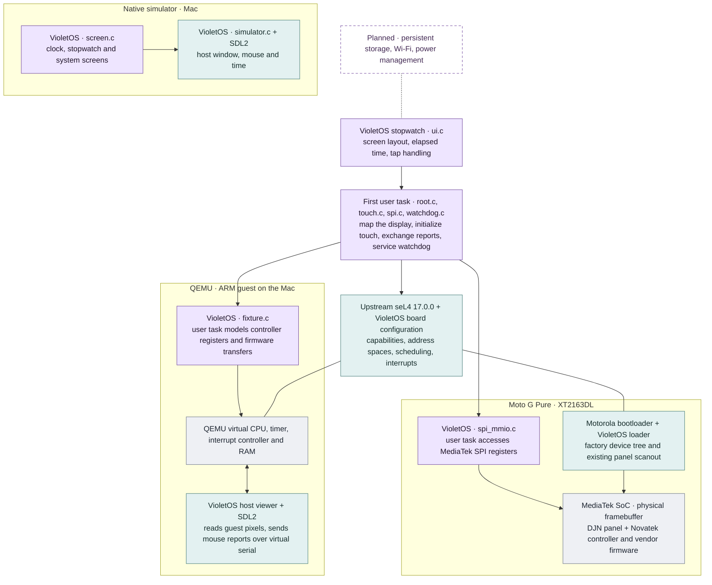

# VioletOS

VioletOS boots a touch-driven stopwatch on a Moto G Pure XT2163DL and runs the same stopwatch code on seL4 in QEMU. On the phone, tapping **Stopwatch → Start** exercises the panel, touch controller, driver and UI. On the Mac, the emulator shows the pixels drawn by the guest and sends mouse clicks back through its touch driver.

## Run it on the Mac

| Command | What you get |
| --- | --- |
| `make emulator` | A clickable seL4 window. Open **Stopwatch**, click **Start**, then try **Pause** and **Reset**. Close the window or press Escape to quit. |
| `make sim` | The original native SDL simulator, including its clock and system screens. Use it for quick layout and interaction experiments. |
| `make test-emulator` | Eight QEMU scenarios covering stopwatch behavior, touch transfer failures, recovery and watchdog handling. The tests read the guest's rendered pixels. |
| `make` or `make moto` | The handset image at `build/sel4/moto/boot.img`. This command builds locally. Installing it is a separate operation. |

On an Apple Silicon Mac, install the Xcode command-line tools, Python 3, and the Homebrew packages below. The simulator needs only the host C toolchain, Make and SDL2.

```sh
brew install qemu sdl2 cmake ninja dtc
```

For either seL4 target, install Android NDK **28.2.13676358** for its ARM cross-compiler. The build looks under `~/Library/Android/sdk/ndk/28.2.13676358`. Set `ANDROID_NDK_HOME` if it lives elsewhere. The first build downloads pinned seL4 and libfdt sources, checks their SHA-256 hashes and installs the Python build dependencies in a local virtual environment. QEMU can build and run without a handset or factory files. The interactive launcher has been tested on this Mac.

## How the layers fit together

Read from the top down. The **Moto and QEMU columns share the purple upper layers**. The UI and drivers live together in one C program, the first user task started by seL4. The kernel controls which physical memory and device registers that task can access. Once mapped, the task can draw pixels and talk to the controller directly. The desktop simulator has its own event loop and UI implementation.



**Purple** is code in this repository. **Teal** combines our integration with upstream or vendor components. **Gray** is external. **Dashed** marks future work. The loader runs at boot and hands control to seL4. This board configuration, the loader, the drivers and the stopwatch have no end-to-end formal verification claim.

## Where to change the code

| If you want to change… | Start here | Where it runs |
| --- | --- | --- |
| A button, stopwatch timing or framebuffer drawing | [ui.c](platform/sel4/stopwatch/ui.c). Both UI implementations use the [bitmap font](src/glyphs.h). | Moto and QEMU user task |
| How the first task obtains device mappings | [root.c](platform/sel4/stopwatch/root.c) and [platform.h](platform/sel4/stopwatch/platform.h) | Moto and QEMU user task |
| How a touch becomes a tap | [touch.c](platform/sel4/stopwatch/touch.c) initializes the Novatek controller and decodes contacts. [spi.c](platform/sel4/stopwatch/spi.c) drives each transfer. [spi_mmio.c](platform/sel4/stopwatch/spi_mmio.c) accesses real registers, while [fixture.c](platform/sel4/stopwatch/fixture.c) models them. | Shared driver with one backend per target |
| Watchdog behavior | [watchdog.c](platform/sel4/stopwatch/watchdog.c) | Moto and QEMU user task |
| Where seL4 comes from and how it boots | [build_sel4.py](tools/build_sel4.py) pins and fetches upstream seL4, applies the [board configuration](platform/sel4/board/) and builds a kernel per target. The [loader](platform/sel4/loader/) prepares memory and transfers control to the kernel. | Build host and early ARM boot |
| The Moto image layout | [loader/build.py](platform/sel4/loader/build.py) links the payload. [phone_image.py](tools/phone_image.py) reads and packages the Android v2 boot format. | Build host |
| How the Mac window talks to the guest | [run.py](tools/run.py) starts QEMU. [viewer.c](tools/emulator/viewer.c) displays its 720 × 1600 framebuffer and translates mouse events into touch reports. [test.py](platform/sel4/stopwatch/test.py) checks the driver and rendered output. | Mac host |
| The native simulator | [screen.c](src/screen.c) owns its UI and state. [simulator.c](src/simulator.c) supplies SDL input, display and time. | Native host process |

For example, change the **Start** label in `ui.c` and both seL4 targets pick it up. Change `spi_mmio.c` and only the Moto build changes. To mirror a design change in the native simulator, edit `screen.c` as well.

## Handset build and validation

The supported handset is **XT2163DL** (board **ellis**) with firmware **S3RHS32.20-42-13-2-3-2** and the DJN NT36525B-A panel. Supply the two local vendor files below. The build checks both against their expected digests.

```sh
export VIOLET_STOCK_BOOT=/path/to/exact-factory/boot.img
export VIOLET_TOUCH_FW=/path/to/djn_nt36525b_a_novatek_ts_fw.bin
make moto
shasum -a 256 build/sel4/moto/boot.img
```

The rebuilt handset image has SHA-256 `19377b26ea4c304b612599baf7d09ad9a19cc7371e8432a2dddb98a8bc44188d`. On the unlocked test handset, this image booted from slot B, displayed **TOUCH READY** and accepted taps to open and start the stopwatch. Android occupied slot A. QEMU exercises the same touch protocol with synthetic firmware and modeled registers. Physical panel initialization, electrical behavior and bootloader slot selection still require a handset.

Persistent disk storage, Wi-Fi and power management are planned. The current guest keeps stopwatch state in RAM. The [Rust isolation experiment](spikes/sel4-isolation/) explores separating services. The [handset bring-up log](spikes/sel4-ellis/) records the hardware trials. The [original architecture deck](docs/VioletOS-architecture.pdf) documents the earlier Linux prototype.

### Rust toolchain

The stopwatch state machine builds with Rust 1.91.1 and the `armv7a-none-eabi` target. Install the target with `rustup target add armv7a-none-eabi` and put `rustc` on PATH (or set `RUSTC`). Run its host tests with `rustc --test platform/sel4/services/lib.rs -o build/state-tests && build/state-tests`.

On the development Mac a single warm QEMU image build took 0.98 s before this port and 1.50 s afterward. The QEMU payload grew from 239,912 to 240,488 bytes. Android boot-image padding kept the Moto package at 12,109,824 bytes. These measurements concern the state-machine port alone.
