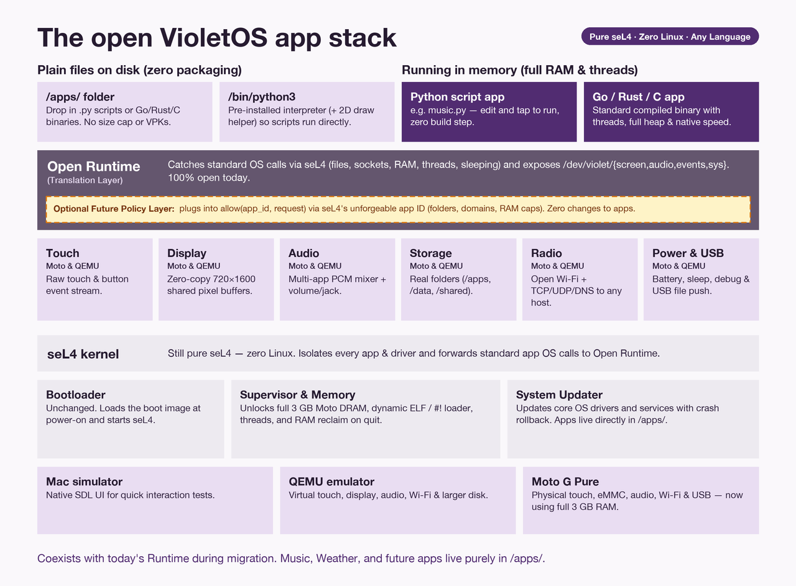

# VioletOS

VioletOS is a smartphone operating system built on the seL4 microkernel. It runs on the Moto G Pure (XT2163DL) and in QEMU on a Mac, with no Linux kernel anywhere. Drivers and services are separate seL4 processes, mostly written in Rust. Apps come in two kinds:

- **System components** (the boot [launcher](apps/launcher/README.md)) are small `no_std` Rust programs that talk to **Runtime**, VioletOS's own app interface.
- **Open apps** are ordinary Linux ARM programs (Rust `std`, C, Go, or a `#!/bin/python3` script) dropped into `/apps`. The phone ships with [Home](apps/open/home), [Ladybird Browser](apps/open/ladybird/README.md), [Bitchat](apps/open/bitchat/README.md), [Violet Agent](apps/open/agent/README.md), Locomo Music and [Settings](apps/open/settings/README.md), all open apps written in Rust. Apps Violet Agent builds get their own icons on Home after these. The **Open Runtime** runs them unmodified by answering their Linux system calls. See the [Open Runtime](runtime/open/README.md) and its [RFC](docs/open-app-model-rfc.md).

The look is dark layered paper with cream icons pressed into it ([paper.rs](apps/lib/violet/src/paper.rs)). Wi-Fi, Bluetooth, the phone link (Violet Shield and Phone Internet), the clock's city, deleting Agent-built apps and the passcode are all in Settings. The top 32 rows of the screen are the system's: a band no app can draw over says which app is in front, and turns violet with `VIOLET SYSTEM` for the runtime's own permission prompts, passcode keypad and lock screen ([Open Runtime](runtime/open/README.md), Trusted system UI). The power button turns the screen off, which locks the phone when a passcode is set, and turns it on again; holding it offers to power off.

**Rust is the preferred language for new VioletOS code**, including services, drivers and application logic.

## Run it on the Mac

| Command | What you get |
| --- | --- |
| `make emulator` | A clickable seL4 window (the AArch64 system; `make emulator32` for the 32-bit one) that boots straight to Home. Sound plays through the Mac's speakers; the arrow keys are the volume buttons, **H** plugs in headphones and **P** is the power button (tap to turn the screen off or on, hold to power off). Close the window or press Escape to quit. |
| `make sim` | The original native SDL simulator, including its clock and system screens. Use it for quick layout and interaction experiments. |
| `make test-emulator` | Eight QEMU scenarios covering touch transfer failures, controller recovery and watchdog handling; where touch works, a tap on Home must open Settings. |
| `make test-isolation` | Boots a diagnostic image and checks that seL4 faults when the UI tries to read touch registers, disk registers or the disk transfer buffer. |
| `make test-audio` | Holds the virtual volume buttons, plugs in headphones, plays sounds and records a tone from the Sounds test program, then checks the PCM, the recording and the on-screen volume. |
| `make test-local` | **The loop to run before pushing**: `make test-unit` (host tests, with the integration tests), `make test-system` (the AArch64 end-to-end test), `make test-ci` (the two QEMU tests CI runs) and `make test-system32` (the 32-bit end-to-end test). See [Testing](#testing). |
| `make test-integration` | Host only, about 4 seconds: some 200 tests that run the shipped Open Runtime, Storage, Power and package-manager sources against in-memory fakes of the kernel and hardware, in parallel. The capability policy, memory protection, signals, the app lifecycle and low-memory killer, sockets, the trusted UI and passcode lock, Shield enforcement, wake locks and governors, network time and full-system updates. See [tests/integration](tests/integration/README.md). |
| `make test-system` | The AArch64 end-to-end test: verified boot (the image starts; a changed kernel byte, a changed root task byte and an old version are refused), then one boot through every layer to Home, 64-bit programs' signals, posix_spawn, fork and the 47-bit layout, and the timekeeper's timer, which apps cannot touch. See [targets/qemu64](targets/qemu64/README.md#the-violetos-system-on-aarch64). |
| `make test-system32` | The 32-bit end-to-end test, for what needs the real kernel, MMU or boot path: one image, two boots. The Linux ABI from C, Rust and Go (signals, fork, execve, the dynamic loader), W^X on real page tables, the capability policy and the Shield's side doors through the real system call dispatch, an older and a forged update refused, a signed system update staged in the other slot, booted as a trial and marked successful, and a passcode set in the first boot locking the second. See [test_system.py](targets/qemu/test_system.py). |
| `make test-net-lwip` | Radio's socket code for open apps against lwIP itself, on this Mac (a second; needs lwIP's source from an image build): a slot reused mid-stream, connections that never finish closing, names nobody answers. |
| `make test-open` | Runs unmodified Linux ARM programs under the Open Runtime, started from their Home icons: Rust, C, Go and Python, including drawing, touch, PCM audio and TCP. The programs live in [targets/qemu/open-test-apps](targets/qemu/open-test-apps) and only this test's image carries them. |
| `make test-wifi-app` | Drives Settings › Wi-Fi by touch: scans, types a wrong and then the right WPA2 password on the on-screen keyboard, switches to an open network, and rejoins with the saved key after a reboot. |
| `make test-wpa` | Host only, no QEMU: the handset's WPA2 client against an independent authenticator, PSK and PSK-SHA256, with and without 802.11w protected management frames (fetches hostap's sources once). |
| `make test-open-apps` | Drives Home, Settings (a chosen city kept in `/data` across a restart, Wi-Fi, Agent Apps) and Music. |
| `make test-lock` | The power key, the screen lock and power off: the key turns the screen off and on, Settings sets a passcode, the key then locks, the passcode unlocks, the phone starts locked after a restart, and the power sheet powers off. See [Power](services/power/README.md). |
| `make test-shield` | Violet Shield end to end in QEMU with the Python companion simulator. Signed warnings appear on Home while the demo apps keep running. See [the proof of concept](docs/violet-shield-poc.md). |
| `make test-agent` | The voice agent in QEMU with the real Mac app: QR pairing through a local relay, an encrypted install that survives a restart and gets a Home icon, Python installed as a package with a Python app, listening from the background, deleting an app from Settings, reconnect and unpair. See [the agent](apps/open/agent/README.md) and [Violet Agent for macOS](companion/mac/README.md). |
| `make test-rose` | Rose as the agent, in QEMU with the real Mac app: a typed request becomes her build task, the app is built and installed on the phone, she talks during the build and announces it. Needs Codex signed in and `companion/mac/violet_rose/setup.sh`. |
| `make test-locomo` | Generates a Cool Jazz track in the signed Locomo Music release, transfers it over the paired connection and checks audio in QEMU. See [Locomo Music](companion/mac/README.md#locomo-music). |
| `make test-ladybird` | Drives the Ladybird browser by touch: links, a linked style sheet, Back, scrolling and a typed address against a local web server, and HTTPS when the Mac is online. |
| `make` or `make moto` | The handset image, AArch64, at `build/sel4/moto-aarch64/boot.img` (`make moto64` is the same). This command builds locally; installing it is a separate step (see [Handset](#handset)). |
| `make moto32` | The 32-bit handset image at `build/sel4/moto/boot.img` (same factory inputs). |
| `make moto-debug` | Reads handset status over USB. See [USB Diagnostics](services/usb-diagnostics/README.md). |
| `make bitchat-peer` | A Mac bitchat peer for testing the handset's [bitchat](apps/open/bitchat/README.md) app over Bluetooth. |

### Prerequisites

On an Apple Silicon Mac, install the Xcode command-line tools, Python 3 and these Homebrew packages. The native simulator needs only the host C toolchain, Make and SDL2.

```sh
brew install qemu sdl2 cmake ninja dtc
```

The seL4 targets need Rust 1.91.1 with the `aarch64-unknown-none` target (`armv7a-none-eabi` for the 32-bit `qemu32-image` and `moto32`) and Android NDK **28.2.13676358** for its ARM cross-compiler. The build looks under `~/Library/Android/sdk/ndk/28.2.13676358`; set `ANDROID_NDK_HOME` if it lives elsewhere. Put `rustc` on PATH (or set `RUSTC`). The first build downloads pinned seL4, libfdt and TLS sources, checks their SHA-256 hashes and installs the Python build dependencies in a local virtual environment. QEMU builds and runs without a handset or factory files.

The open apps in [`apps/open`](apps/open) need their own toolchains. Each is optional: a program whose toolchain is missing is left out of the image, and `make test-open` reports it as skipped.

| For | Install |
| --- | --- |
| Rust `std` programs | `rustup target add aarch64-unknown-linux-musl` (`armv7-unknown-linux-musleabihf` for the 32-bit image); or `python3 targets/qemu64/toolchain.py` |
| The Ladybird browser | `rustup toolchain install 1.98.0 --target aarch64-unknown-linux-musl` (and `armv7-unknown-linux-musleabihf` for the 32-bit image; Ladybird's Rust version); the build fetches the pinned Ladybird sources |
| Go programs | `brew install go` |
| C programs | `make qemu-image` builds the AArch64 musl sysroot with the NDK's clang (`VIOLET_ARCH=aarch64 python3 tools/build_python.py musl`; `VIOLET_ARCH=aarch32` for the 32-bit one) |
| `/bin/python3` | `brew install python@3.12`, then `VIOLET_ARCH=aarch32 python3 tools/build_python.py python` (cross-builds CPython 3.12 with zlib; the 32-bit image carries it) |

## Architecture



From the bottom up:

1. **seL4 kernel** ([kernel/sel4](kernel/sel4/README.md)). A pinned upstream seL4, for AArch64 by default ([kernel/sel4/aarch64](kernel/sel4/aarch64/README.md)) and for AArch32, built per target with the [board configuration](platform/sel4/board/). It is not a verified seL4 configuration; the kernel README lists every difference from upstream, and the build checks the list. The [loader](boot/loader/README.md) checks the handset's live memory map, stages the kernel and first task, and enters seL4.
2. **Supervisor** ([system/supervisor](system/supervisor/README.md)). The first task. It reads the package catalog, builds every process's address space and capabilities, maps each device into exactly one process, starts everything, and restarts the group or rolls back to the previous catalog after a fault or stall. The [package manager](system/package-manager/README.md) installs and removes components.
3. **Services**, one process per device or function. Only the service that owns a device can touch it.
4. **Two app interfaces.** [Runtime](runtime/README.md) gives built-in apps Subscribe, Get and Execute operations over a 14-word IPC message, decides which app is in front, and routes requests to services through worker threads. The [Open Runtime](runtime/open/README.md) gives open apps the Linux ARM system call interface plus `/dev/violet/{screen,events,sys,audio}`, and is itself one of Runtime's clients.
5. **Apps.** Built-in apps draw into a private 240 × 400 surface that Display scales to the screen. Open apps `mmap` a full 720 × 1600 buffer.

USB Diagnostics runs only on the handset and serves developer tools on a connected Mac. The [iPhone companion](companion/ios/README.md) relays the handset's traffic over cellular data (Phone Internet).

**The voice agent.** [Agent](apps/open/agent/README.md) on the phone pairs with [Violet Agent for macOS](companion/mac/README.md) by a one-time QR code and then meets it through a relay (a [Chariot](tools/chariot-relay/relay.py)) from any network, encrypted end to end ([protocol](docs/agent-protocol.md)). You talk to the phone, and the agent you talk to is Rose, RoseOS's voice agent, running on the Mac whole: her voice, her Codex conversation, her tasks, her name and voices, and her life and journal ([companion/mac/roseos](companion/mac/roseos), kept in step with `tools/sync_rose.py`). She has the apps you ask for built and installed on the phone, where they stay. Say "Make me a simple scorekeeper" and it is on the phone in under 20 seconds; apps can be Rust or Python ("make it in Python"). It keeps listening when you leave the Agent app, and keeps talking with you while an app builds.

### Components

Each component is a package in the [catalog](image/catalog/components.json); its number is also its identity to the supervisor.

| ID | Component | Role |
| --- | --- | --- |
| 1 | [Launcher](apps/launcher/README.md) | The boot process: hands the screen to the Open Runtime, restores QEMU's radio choice, and starts the handset's USB Wi-Fi jobs. |
| 3 | [Runtime](runtime/README.md) | The built-in app interface, focus and routing. |
| 4 | [Touch](services/touch/README.md) | Novatek touch controller over SPI. |
| 5 | [Display](services/display/README.md) | The [compositor](system/compositor/README.md): clips, scales and presents built-in apps' surfaces, with damage tracking and a measured frame budget. The Open Runtime still draws to scanout itself while an open app is in front. |
| 6 | [Storage](services/storage/README.md) | Checkpoints, per-app files and the package catalog on disk (virtio in QEMU, eMMC on the handset). |
| 7 | [Radio](services/radio/README.md) | Wi-Fi: scan, WPA2, DHCP, DNS, TCP and TLS; hosts the Phone Internet network; serves open apps' TCP sockets and, on the handset, Bluetooth HCI. |
| 8 | [Power](services/power/README.md) | Battery, the power key, sleep and shutdown, wake locks, the thermal and frequency governors (emulator only so far); brokers the PMIC for Audio and Camera. |
| 9 | [Package manager](system/package-manager/README.md) | Installs, removes and rolls back components. Always loaded from the factory image. |
| 15–20 | Runtime workers | Runtime's per-service request threads. |
| 21 | [USB Diagnostics](services/usb-diagnostics/README.md) | Handset only: status, package staging, flashing and test requests from the Mac. |
| 22 | [Audio](services/audio/README.md) | Speaker, headphones, jack, volume buttons, microphone, and open apps' PCM. |
| 24 | [Open Runtime](runtime/open/README.md) | Runs Linux ARM programs from `/apps`. |
| 25 | [Camera](services/camera/README.md) | The rear camera's sensor, receiver and frames, for open apps' `/dev/violet/camera` (no app uses it now). |
| 26 | [Sentinel](system/sentinel/README.md) | Decides the Open Runtime's capability policy and paths, keeps the user's consent answers (sealed on disk) and runs the Shield's on-device scorer, in its own address space. The Open Runtime asks it and refuses without a clear yes; it does not constrain a compromised Open Runtime, which supplies every input. |

Slot 23 is reserved for a Bluetooth service. Today Radio carries Bluetooth on the handset, since the controller shares the connectivity chip and its BTIF port with Wi-Fi ([bring-up notes](targets/moto-g-pure/bluetooth-bringup.md)).

### What runs today

| | QEMU on a Mac | Moto G Pure |
| --- | --- | --- |
| Boot, supervisor, recovery and rollback | Yes | Yes, from slot B, with Android kept on slot A |
| Touch and display | Mouse clicks become touch reports | Novatek touch on either DJN panel |
| Storage | Virtual disks | eMMC volume inside boot B; app data survives reboot |
| Wi-Fi | Virtual access points, open and WPA2; HTTPS through the Mac | Scan, choose and type the password in Settings › Wi-Fi (WPA2-Personal), or provision over USB; HTTPS UUID |
| Phone Internet | — | Hosts a Wi-Fi network for the iPhone relay; traffic leaves over cellular |
| Audio | Mac speakers and microphone | Speaker, headphones, jack, Volume Down and microphone (Volume Up not yet) |
| Bluetooth LE | — (the app reports the controller off) | Raw HCI for open apps through `/dev/violet/hci` while Wi-Fi is joined; [bitchat](apps/open/bitchat/README.md) chats with the iOS app |
| Camera | A synthetic sensor (colour bars) | Rear Hi-1336 at 1280 × 720, 30 frames per second (the service; no app ships for it now) |
| Open apps | Rust, C, Go and Python, with screen, touch, audio and TCP | Rust, C, Go and Python; PCM audio; TCP over Wi-Fi |

On the handset, apps are started from Home by touch, or from the Mac over USB (for example `build/moto-package open-run=/apps/hello` and `build/moto-package open-log`).

## Code organization

```
apps/                 Built-in apps (no_std Rust) and open apps
  launcher/           the boot process (no_std); drawing.rs is shared
  open/               the phone's apps for /apps: home, settings, ladybird, bitchat, agent, music
  lib/violet/         the open apps' shared Rust crate: devices, drawing, the paper look and icons, text, HTTPS
  examples/           Sketches from the open app model RFC
runtime/              Runtime: protocol.rs (wire format and keys), process.rs, lanes.rs (workers), sdk.rs (app side)
  open/               Open Runtime: syscalls, devices, sockets, file system, memory pool
  arch/               What differs between AArch32 and AArch64 (the qemu64 bootstrap task and the Open Runtime's AArch64 calls)
services/             One folder per service: touch, display, storage, radio, power, audio, camera, usb-diagnostics
system/
  supervisor/         The first task (supervisor.c) and the open apps' process manager (procmgr.rs)
  compositor/         Who owns which rows and touches, damage, software blits, the frame budget (run by Display)
  package-manager/    Catalog transactions on the device and manage.py on the Mac
image/                Component catalog and the package format and builder
kernel/sel4/          seL4 download, patches and build
platform/sel4/        Board configuration, shared headers, the loader and image build
boot/loader/          The loader that runs before seL4
targets/
  qemu/               QEMU backends (audio, power, touch fixture) and the QEMU test suites
  moto-g-pure/        Handset backends: Wi-Fi driver, lwIP and WPA2, audio, eMMC, power; handset tests
  board/              Board descriptions (handset, QEMU, QEMU AArch64): memory map and device windows as data
  qemu64/             The AArch64 target: a 64-bit kernel, a bootstrap task, and stack.py, the whole system for AArch64 QEMU
  mac-simulator/      The native SDL simulator
tests/integration/    Host integration tests: the shipped sources joined by in-memory fakes of the kernel and hardware
tools/                Build and run on the Mac: run.py, the emulator viewer, image builders, network and USB helpers
companion/ios/        Violet Relay, the iPhone app for Phone Internet
companion/mac/        Violet Agent, the Mac half of the voice agent
docs/                 Architecture slides, the open app model RFC and the relay plan
spikes/               Earlier experiments and the handset bring-up log
src/, include/        The native simulator's UI, the bitmap font and shared headers
```

Code that differs between QEMU and the handset lives under `targets/` behind a common interface. For example, Audio builds [services/audio/process.rs](services/audio/process.rs) with either [targets/qemu/audio.rs](targets/qemu/audio.rs) or [targets/moto-g-pure/audio.rs](targets/moto-g-pure/audio.rs).

## Where to change the code

| If you want to change… | Start here | Where it runs |
| --- | --- | --- |
| Home, Settings or another app's screen | Its folder under [apps/open](apps/open); the shared look (paper, icons, buttons) is [paper.rs](apps/lib/violet/src/paper.rs). `HOME_PREVIEW=out.raw cargo test -p home` and `SETTINGS_PREVIEW=dir cargo test -p settings` draw previews on the Mac. | Moto and QEMU |
| What built-in apps can ask for | [protocol.rs](runtime/protocol.rs) defines the keys; [process.rs](runtime/process.rs) decides who may use them and routes them. | Moto and QEMU |
| Which Linux calls open apps get | [syscall.rs](runtime/open/syscall.rs), with [sockets.rs](runtime/open/sockets.rs), [device.rs](runtime/open/device.rs) for `/dev/violet` and the app list, and [fs.rs](runtime/open/fs.rs) for files. | Moto and QEMU |
| How open apps are loaded and paged | [procmgr.rs](system/supervisor/procmgr.rs) and [pool.rs](runtime/open/pool.rs). | Moto and QEMU |
| What goes into `/apps` | [build_initfs.py](tools/build_initfs.py); Python itself comes from [build_python.py](tools/build_python.py). | Build host |
| Which process gets which device, memory or endpoint | [supervisor.c](system/supervisor/supervisor.c) and [platform.h](platform/sel4/include/platform.h). | Moto and QEMU |
| How a touch becomes a tap | [touch.rs](services/touch/touch.rs) and [spi.rs](services/touch/spi.rs); [spi_mmio.c](targets/moto-g-pure/spi_mmio.c) accesses real registers, [fixture.c](targets/qemu/fixture.c) models them, and [events.c](services/touch/events.c) carries events to Runtime. | Shared driver, one backend per target |
| Durable app data | [storage.rs](services/storage/storage.rs), [files.rs](services/storage/files.rs), [journal.rs](services/storage/journal.rs); [block.rs](services/storage/block.rs) (virtio) or [emmc.rs](targets/moto-g-pure/emmc.rs). | Moto and QEMU |
| Wi-Fi, TCP and TLS on the handset | [radio.rs](targets/moto-g-pure/radio.rs) (Radio's event loop), [wlan_axi.rs](targets/moto-g-pure/wlan_axi.rs) (the chip), [wpa.rs](targets/moto-g-pure/wpa.rs), and lwIP glue in [ip/](targets/moto-g-pure/ip/) ([sockets.c](targets/moto-g-pure/ip/sockets.c) serves open apps). | Moto |
| Bluetooth on the handset | [bt.rs](targets/moto-g-pure/bt.rs) (the controller and the HCI pages) and [wmt.rs](targets/moto-g-pure/wmt.rs) (STP and WMT); [hci.rs](runtime/open/hci.rs) is `/dev/violet/hci`. | Moto |
| Networking in QEMU | [services/radio](services/radio/README.md) with the Mac-side [emulator_endpoint.py](tools/emulator_endpoint.py) and, for open apps' sockets, [net_relay.py](tools/net_relay.py). | QEMU and the Mac |
| The power key, the screen lock and power off | [power.rs](runtime/open/power.rs) and its rules in [lock.rs](runtime/open/lock.rs); Home's lock screen is [lock.rs](apps/open/home/src/lock.rs); the key itself comes from [Power](services/power/README.md). | Moto and QEMU |
| Sound and the microphone | [services/audio](services/audio/README.md) and the board backend under `targets/`. | Moto and QEMU |
| Watchdog behavior | [watchdog.c](platform/sel4/board/watchdog.c) | Moto and QEMU |
| Where seL4 comes from and how it boots | [kernel/sel4/build.py](kernel/sel4/build.py), the [board configuration](platform/sel4/board/) and the [loader](boot/loader/). | Build host and early ARM boot |
| The handset image layout | [loader/build.py](platform/sel4/loader/build.py) links the payload; [phone_image.py](tools/phone_image.py) writes the Android v2 boot format, with the `/apps` image as its ramdisk. | Build host |
| How the Mac window talks to the guest | [run.py](tools/run.py) starts QEMU and the Mac-side helpers; [viewer.c](tools/emulator/viewer.c) shows the 720 × 1600 framebuffer, plays and records sound, and turns mouse events into touch reports. | Mac |
| The native simulator | [screen.c](src/screen.c) and [simulator.c](targets/mac-simulator/simulator.c). | Native host process |

For example, change a label in `apps/open/settings/src/pages.rs` to update both seL4 targets. Change `spi_mmio.c` and only the handset build changes.

## Try it in QEMU

`make emulator` boots to Home: the date, the Violet Shield pill, and an icon for each app. Tap an icon to open it; every app has a **‹ Home** button, and holding the top edge for a second also comes back. Tap **Settings** for Wi-Fi (the emulator offers three virtual networks), Bluetooth, Phone Link, Date & Time (the city whose date Home shows), Agent Apps, Passcode, Power and About. Press **P** to turn the screen off and again to turn it on; once a passcode is set, that locks the phone. **Ladybird Browser** opens a start page of links; tap the address bar to type any address.

### Persistence

Open apps keep files in `/data`, which the Open Runtime writes back to Storage and loads on the next boot: Settings' saved networks and Phone Internet code, the shared settings, and so on. QEMU keeps them on a 1 MiB raw disk in `build/sel4/qemu`; the handset uses the same code with an MSDC0 block driver (see the [handset storage layout](targets/moto-g-pure/README.md#handset-storage)). Apps Violet Agent installs live in their own extent of the disk and survive restarts too.

### AArch64 (the default) and AArch32

Since November 28, 2026 AArch64 is the default architecture for every build and the tests that cover it (`image/packages/violet_arch.py`). On QEMU `virt` (Cortex-A53) `make qemu-image` builds the same pinned seL4 as a 64-bit kernel, the Supervisor, the Rust and C services, Storage's `/data`, the Sentinel and the Open Runtime with its policy and Shield, and Home, Settings, Music and Ladybird as 64-bit Linux programs (see [targets/qemu64](targets/qemu64/README.md) for the layer table and each check). `make emulator`, `make test-emulator`, `make test-system`, `make test-ci` (and CI), `make test-open-apps` and `make test-ladybird` boot it. The 32-bit system stays buildable and tested: `make qemu32-image`, `make emulator32`, `make test-system32` (in `make test-local`), `make moto32`; the suites whose test programs exist only for it (`test-isolation`, `test-audio`, `test-open`, `test-memory`, `test-wifi-app`, `test-packages`, `test-agent`, `test-shield`, the `test-moto-*` handset tests) build and boot the 32-bit image.

The supervisor's timekeeper runs there too, with a timer only it can program: the 64-bit kernel enables the EL0 physical timer only while a thread the supervisor flagged runs ([kernel/sel4/aarch64](kernel/sel4/aarch64/README.md#why-the-physical-timer-is-given-per-thread)), so services and the Open Runtime sleep (QEMU at idle Home: 18% of a host core instead of 100%) and no app can stop or move anyone's wake-up. Verified boot is there too (the entry stub checks the kernel and the supervisor against the signed manifest and the rollback floor, [verify.c](targets/qemu64/verify.c)), as are fork without `CLONE_VM` and the 47-bit address layout (`vma::Layout64`). What is not there on AArch64: a few calls whose structures are not converted, an end-to-end check of the trusted UI's lock, and the policy probe and C/Go ABI programs `make test-system32` runs on AArch32. `test_system.py` prints any layer `differences.json` lists as absent, never as a pass (now none), and checks that an app's access to the timer traps.

The handset runs it too: `make moto64` builds a boot image whose header asks MediaTek's LK for a 64-bit kernel, with a 64-bit loader ([loader64.S](boot/loader/loader64.S) and the shared [loader.c](boot/loader/loader.c)), the AArch64 kernel built for the handset, and the handset's Supervisor, services (display, touch, eMMC storage, power, USB Diagnostics, Radio with Wi-Fi), Sentinel, Open Runtime and open apps for AArch64. On the XT2163DL it boots in about 8 s to the Open Runtime's screen (Home, behind the lock screen when a passcode is saved), answers on USB Diagnostics, keeps the saved `/data`, scans Wi-Fi and fetches a UUID over verified HTTPS ([the record](targets/moto-g-pure/README.md#aarch64-boot-path)). It also carries Camera (its frame window as two 2 MiB frames, not yet exercised on the phone) and the timekeeper with the per-thread timer. Its loader verifies the kernel and the supervisor (accepted and, with one changed kernel byte, refused on the phone; the bootloader is unlocked, so this catches corruption, not a replaced image), and once the system is healthy it marks its boot slot successful in Android's `bootloader_control` record, which LK reads: B's tries are no longer spent on every boot. This is the default handset build (`make moto`); `make moto32` builds the 32-bit one.

## Handset

The supported handset is the **XT2163DL** (board **ellis**) with firmware **S3RHS32.20-42-13-2-3-2**, on either DJN NT36525B panel revision: the loader reads which panel the bootloader lit, and Touch loads the matching firmware. Supply the stock boot image and both panel firmware files. Next to the stock boot image, create a `wifi/` folder with the files listed in the [radio firmware manifest](targets/moto-g-pure/wifi_firmware.py), copied from the factory vendor image's firmware directory. The build checks each input against its pinned SHA-256 digest.

```sh
export VIOLET_STOCK_BOOT=/path/to/exact-factory/boot.img
export VIOLET_TOUCH_FW=/path/to/djn_nt36525b_a_novatek_ts_fw.bin
make moto
```

VioletOS boots from slot B and leaves Android on slot A. With USB connected, `services/usb-diagnostics/host/moto-flash build/sel4/moto-aarch64/boot.img` (`build/sel4/moto/boot.img` for `make moto32`) reaches fastboot without touching the phone, flashes slot B and waits for VioletOS to answer. On a handset whose slot B has no valid bootloader images yet (`WARNING: Bootloader images on target slot b are not valid!!`), see [flashing a slot-A-only handset](targets/moto-g-pure/README.md#flashing-a-slot-a-only-handset-empty-slot-b). The boot image carries the loader, seL4, the first task and its catalog, the Wi-Fi firmware and, in place of Android's ramdisk, the compressed `/apps` image. A 1 MiB storage volume and the catalog banks follow it in the partition.

Useful tools on the Mac:

- `build/moto-debug` prints a status snapshot; `build/moto-package` stages packages, reboots, plays sounds, reads the Open Runtime's log and starts open apps. See [USB Diagnostics](services/usb-diagnostics/README.md).
- `services/usb-diagnostics/host/moto-wifi-profile` provisions a WPA2 network for the current boot (it asks for the password privately), then `build/moto-package join-wifi` joins it and fetches a UUID over HTTPS.
- `services/usb-diagnostics/host/moto-relay` hosts the Phone Internet network for [Violet Relay](companion/ios/README.md) on an iPhone.

The [handset README](targets/moto-g-pure/README.md) records the bring-up and each validation. The [handset bring-up log](spikes/sel4-ellis/) covers the first trials, and the [original architecture deck](docs/VioletOS-architecture.pdf) the earlier Linux prototype.

## Testing

`make test-local` is the loop to run before pushing. It has four parts:

| Part | What |
| --- | --- |
| `make test-unit` | Every host test, starting with the [integration tests](tests/integration/README.md): the shipped sources of the Open Runtime, Storage, Power and the package manager, built for the Mac and joined by in-memory fakes of the kernel and hardware edges, twice (the shipped 4 KiB pages and the 64 KiB configuration). CI runs this. The whole of `test-unit`: about 50 s measured. |
| `make test-system` | The AArch64 end-to-end test: four short verified-boot boots, then one boot through every layer and the 64-bit programs. |
| `make test-ci` | The two QEMU tests CI runs, on the AArch64 image `test-system` built. |
| `make test-system32` | The 32-bit end-to-end test: one image, two boots, for what needs the real kernel, MMU, boot path or the real system call dispatch; it rebuilds the normal 32-bit image afterwards. |

The target is the whole loop in under 10 minutes. `make test-local` as one command took 261 s (4 min 21 s) on November 28, 2026, on an Apple Silicon Mac with the images already built once (the builds are incremental).

**Write a host integration test, not a QEMU suite.** A new QEMU suite builds its own image and boots it, serially, and eleven of them had grown to about 15 minutes. A test in `tests/integration` builds its own phone in memory, runs in milliseconds beside the others and runs in CI. Use QEMU only for what a host cannot show (real page tables, real signal delivery, the boot path), and add it to [test_system.py](targets/qemu/test_system.py) within its two boots. [docs/test-map.md](docs/test-map.md) lists where every assertion of the old suites went, including the few that were dropped and why.

The older suites (`test-open`, `test-audio`, `test-memory`, `test-wifi-app`, `test-ladybird`, `test-shield`, `test-agent`, `test-packages`, ...) are separate local targets outside the loop: run the one for the area you changed.

## Continuous integration

[GitHub Actions](https://github.com/Immortal-Protocols/VioletOS/actions/workflows/ci.yml) runs on pull requests and pushes to `main`. The Linux job builds the 32-bit QEMU image and runs the host unit tests (`make test-unit`); the macOS job builds the AArch64 system with the open apps it needs and runs two QEMU tests on it (`make test-ci`: one boot of the supervisor and its services, then the open apps). Every other QEMU suite (`make test-open`, `test-agent`, `test-ladybird`, `test-shield`, ...) runs locally.

The AArch64 move was sized before it was made: from an empty tree with CI's settings (no caches, `VIOLET_OPEN_SKIP`, Rust 1.91.1 with the two AArch64 targets), `make test-ci` took 55 s for the 32-bit image and 83 s for the AArch64 one on the same Mac (November 28, 2026). The last 32-bit CI run's `make test-ci` step took 100 s of a 157 s macOS job, so about 150 s and a job near 3.5 minutes are expected; the first AArch64 run will tell.

**Keep CI under 5 minutes.** Don't add QEMU suites to `test-ci` or new jobs to the workflow. If CI must cover something new, add a host integration test (`tests/integration`, run by `make test-unit`) or another host test that runs in seconds, and leave apps CI doesn't need out of its build (`VIOLET_OPEN_SKIP` in the workflow).

The handset image and handset tests need the factory files and run locally. The public HTTPS endpoint test is separate: `make test-wifi-live`.

## Design documents

- [Open app model RFC](docs/open-app-model-rfc.md), with its implementation status.
- [Cellular relay plan](docs/cellular-relay-plan.md) for Phone Internet.
- [Cellular](docs/cellular.md) and [Biometrics](docs/biometrics.md): what the device does not have, and why.
- [Shield data](docs/shield-data.md) and [Shield pairing](docs/shield-pairing.md): collecting real traces, and enrolling a companion's key.
- [Verified boot](docs/verified-boot.md): what the loader checks on QEMU, and why the handset stays unlocked and unverified.
- The original design-review slides: [complete lifecycle stack](docs/violetos-complete-lifecycle-stack.png), [folders and layers](docs/violetos-folders-layer-cake.png), [Runtime contract and updates](docs/violetos-runtime-contract-updates.png) and the [earlier proposed stack](docs/proposed-violetos-stack.png).
