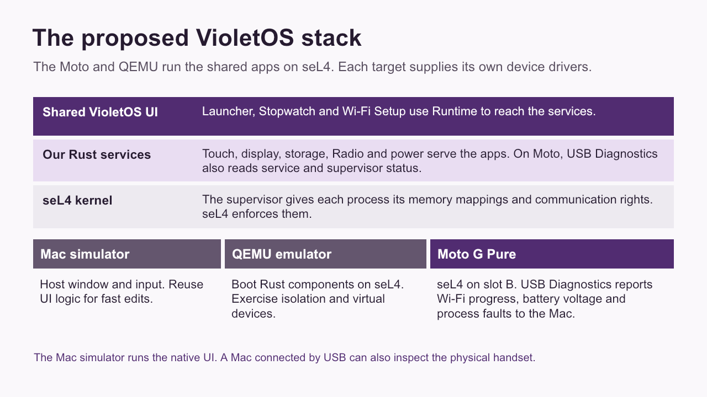
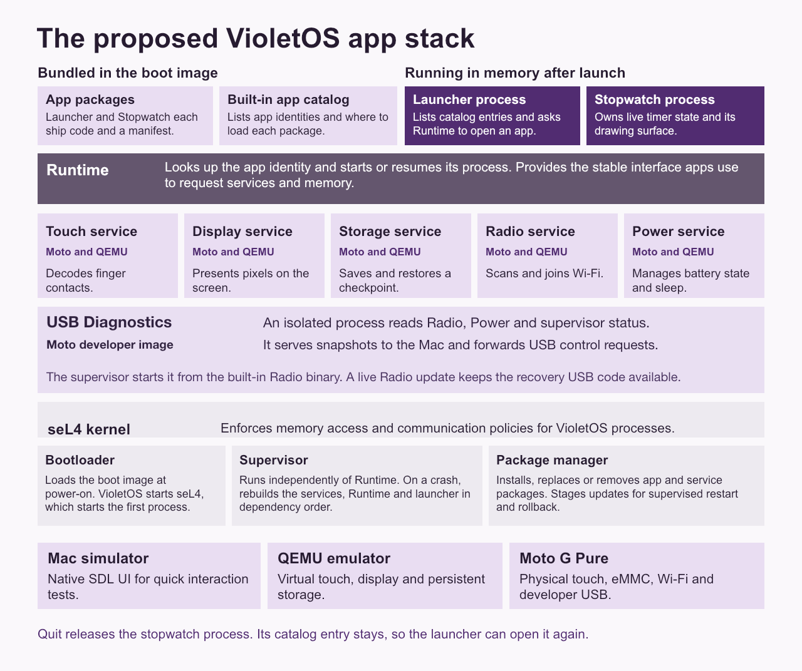
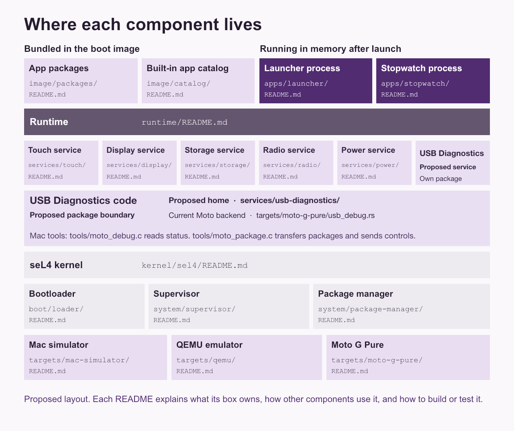
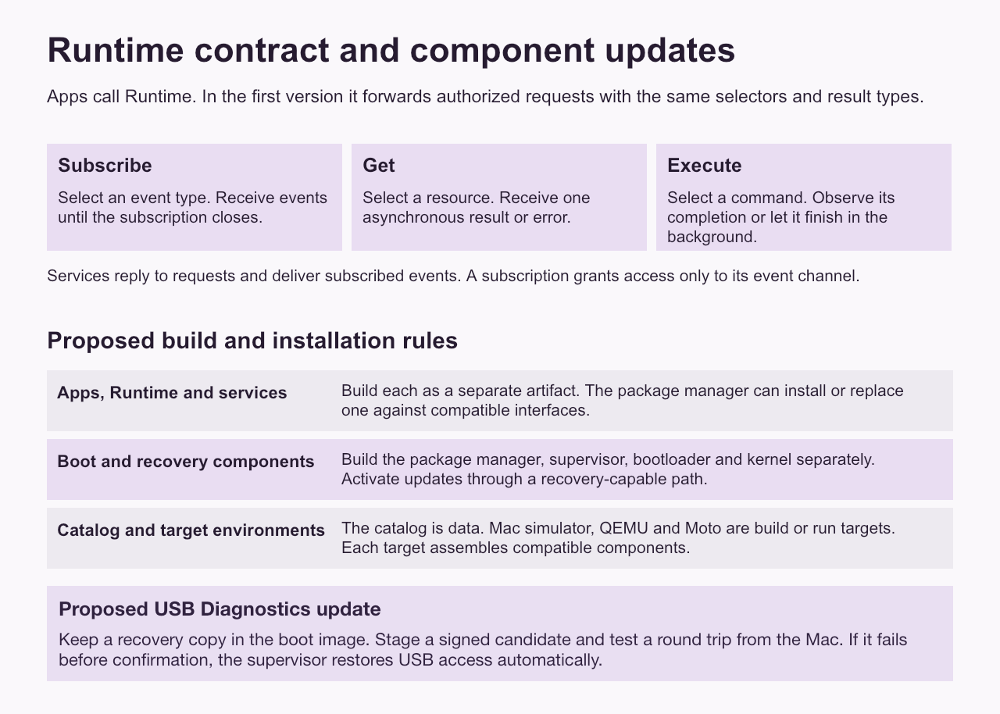

# VioletOS

VioletOS is a seL4 smartphone operating system for the Moto G Pure XT2163DL and QEMU. The Rust stopwatch and touch driver have been tested on the Moto and in QEMU. On the phone, tapping **Stopwatch → Start** exercises the panel, touch controller, driver and UI. On the Mac, the emulator shows the pixels drawn by the guest and sends mouse clicks back through its touch driver.

**Rust is the preferred language for new VioletOS code**, including services, drivers and application logic.

## Run it on the Mac

| Command | What you get |
| --- | --- |
| `make emulator` | A clickable seL4 window. Open **Stopwatch**, click **Start**, then try **Pause** and **Reset**. Close the window or press Escape to quit. |
| `make sim` | The original native SDL simulator, including its clock and system screens. Use it for quick layout and interaction experiments. |
| `make test-emulator` | Eight QEMU scenarios covering stopwatch behavior, touch transfer failures, recovery and watchdog handling. The tests read the guest's rendered pixels. |
| `make test-stack` | Exercises Home, Quit, relaunch, radio, sleep and wake, package removal, installation and crash rollback inside QEMU. |
| `make test-apps` | Installs a separately built fourth app, reads its file after reboot, uninstalls it, and recovers from a stalled service update. |
| `make test-power` | Verifies guest-driven VM pause, resume and shutdown. |
| `make test-wifi-live` | Validates the certificate in the guest and reads the live UUID from the framebuffer. |
| `make test-wifi` | Checks connection, gateway replies, link failure, radio-off handling and saved network selection across QEMU boots. |
| `make test-storage` | Boots seven QEMU guests against a disposable disk to check independent app data, durable reset and torn-sector recovery. |
| `make test-isolation` | Boots a diagnostic image and checks that seL4 faults when the UI tries to read touch registers, disk registers or the disk transfer buffer. |
| `make moto-debug` | Read handset status over USB. See [USB diagnostics](targets/moto-g-pure/README.md#usb-diagnostics). |
| `make` or `make moto` | The handset image at `build/sel4/moto/boot.img`. This command builds locally. Installing it is a separate operation. |

On an Apple Silicon Mac, install the Xcode command-line tools, Python 3, and the Homebrew packages below. The simulator needs only the host C toolchain, Make and SDL2.

```sh
brew install qemu sdl2 cmake ninja dtc
```

For either seL4 target, install the [Rust toolchain](#rust-toolchain) and Android NDK **28.2.13676358** for its ARM cross-compiler. The build looks under `~/Library/Android/sdk/ndk/28.2.13676358`. Set `ANDROID_NDK_HOME` if it lives elsewhere. The first build downloads pinned seL4, libfdt and QEMU radio TLS sources, checks their SHA-256 hashes and installs the Python build dependencies in a local virtual environment. QEMU can build and run without a handset or factory files. The interactive launcher has been tested on this Mac.

## How the layers fit together

This slide from the original design review shows the proposed stack. Its Linux label describes the Moto at the time of the proposal. Slot B now boots seL4.



**What runs today.** In QEMU, the launcher, stopwatch, Wi-Fi Setup, Runtime, touch, display, storage, radio, power and catalog manager are separate seL4 processes. The supervisor starts them from packages and grants their memory and communication rights. The Moto has run the shared launcher, Runtime and stopwatch with physical touch, including switching Home and reopening a running timer. The next image adds the storage service and a handset eMMC backend. The Mac simulator runs its native SDL UI.

Open **Wi-Fi Setup → Connect → Test Radio** to display a fresh UUID from the configured HTTPS endpoint. Choose a virtual access point with **Next Network**. The guest checks the gateway, verifies the HTTPS certificate, and prints the UUID. The Mac relays TCP bytes. [Wi-Fi Setup](apps/wifi/README.md)

In QEMU, start the stopwatch, go **Home**, then reopen it to see the timer still running. **Quit** ends that instance. Reopening it restores the last saved checkpoint. On Home, **Radio** toggles the virtual modem and **Sleep** pauses QEMU until the next tap. **Apps → Off → Confirm** shuts the VM down. See the [package manager guide](system/package-manager/README.md) to replace a component independently.

## Proposed components and interfaces

These three design-review slides describe the planned architecture. The component READMEs below identify current implementations and proposed behavior.







- **Image and apps** — [App packages](image/packages/README.md), [Built-in app catalog](image/catalog/README.md), [Launcher](apps/launcher/README.md), [Stopwatch](apps/stopwatch/README.md).
- **Runtime and services** — [Runtime](runtime/README.md), [Touch service](services/touch/README.md), [Display service](services/display/README.md), [Storage service](services/storage/README.md), [Radio service](services/radio/README.md), [Power service](services/power/README.md).
- **Kernel, boot and recovery** — [seL4 kernel](kernel/sel4/README.md), [Bootloader](boot/loader/README.md), [Process supervisor](system/supervisor/README.md), [Package manager](system/package-manager/README.md).
- **Targets** — [Mac simulator](targets/mac-simulator/README.md), [QEMU emulator](targets/qemu/README.md), [Moto G Pure](targets/moto-g-pure/README.md).

## Where to change the code

| If you want to change… | Start here | Where it runs |
| --- | --- | --- |
| A button, stopwatch timing or framebuffer drawing | [Shared stopwatch app](apps/stopwatch/process.rs) draws the screen on both targets. [stopwatch.rs](apps/stopwatch/state.rs) owns the state transitions. The renderer uses the [bitmap font](src/glyphs.h). | Moto and QEMU userspace |
| How the first task obtains device mappings | [Shared supervisor](system/supervisor/supervisor.c), [Moto register map](targets/moto-g-pure/spi_mmio.c) and [platform.h](platform/sel4/include/platform.h) | Moto and QEMU userspace |
| How a touch becomes a tap | [touch.rs](services/touch/touch.rs) initializes the Novatek controller and decodes contacts. [spi.rs](services/touch/spi.rs) drives each transfer. [spi_mmio.c](targets/moto-g-pure/spi_mmio.c) accesses real registers, while [fixture.c](targets/qemu/fixture.c) models them. | Shared driver with one backend per target |
| How touch events cross address spaces | [events.c](services/touch/events.c) handles the request and reply. The supervisor grants Runtime access to the QEMU touch endpoint. | Moto and QEMU |
| Durable stopwatch checkpoints | [storage.rs](services/storage/storage.rs) handles load and save requests, [journal.rs](services/storage/journal.rs) selects the latest valid record, and [block.rs](services/storage/block.rs) drives the virtual disk. | QEMU storage task |
| Watchdog behavior | [watchdog.c](platform/sel4/board/watchdog.c) | Moto and QEMU userspace |
| Where seL4 comes from and how it boots | [Kernel build](kernel/sel4/build.py) pins and fetches upstream seL4, applies the [board configuration](platform/sel4/board/) and builds a kernel per target. The [loader](boot/loader/) prepares memory and transfers control to the kernel. | Build host and early ARM boot |
| The Moto image layout | [loader/build.py](platform/sel4/loader/build.py) links the payload. [phone_image.py](tools/phone_image.py) reads and packages the Android v2 boot format. | Build host |
| How the Mac window talks to the guest | [run.py](tools/run.py) starts QEMU. [viewer.c](tools/emulator/viewer.c) displays its 720 × 1600 framebuffer and translates mouse events into touch reports. [test_guest.py](targets/qemu/test_guest.py) checks the driver and rendered output. | Mac host |
| The native simulator | [screen.c](src/screen.c) owns its UI and state. [simulator.c](targets/mac-simulator/simulator.c) supplies SDL input, display and time. | Native host process |

For example, change the **Start** label in `apps/stopwatch/process.rs` to update both seL4 targets. Change `spi_mmio.c` and only the Moto build changes. To mirror a design change in the native simulator, edit `screen.c` as well.

## Try persistence in QEMU

Open **Stopwatch → Start → Pause** and note the displayed time. Close the emulator, run `make emulator` again, and open **Stopwatch**. The paused time returns. **Reset** saves zero. Closing while the timer runs restores the last saved checkpoint on the next boot.

QEMU uses a dedicated 1 MiB raw disk at `build/sel4/qemu/stopwatch.disk`. The guest allocates two alternating 512-byte sectors per app. Each holds a version marker, generation number, elapsed tenths and CRC. The storage service acknowledges a save after the device flush completes. On startup it chooses the newest valid record. The screen shows **DISK READY** when the service is available, **RAM ONLY** when it starts without usable storage, and **DISK ERROR** if a save fails.

Runtime identifies the requesting app and selects its private checkpoint. The stopwatch saves elapsed time and the launcher saves its radio preference. Apps can also use named files in a private directory. A separate 4 MiB package disk holds the installed catalog and rollback copy. The Moto build uses the same file and checkpoint code with an MSDC0 block driver. See the [handset storage layout and validation steps](targets/moto-g-pure/README.md#handset-storage). The isolation tests cover CPU access to the mapped regions. The QEMU block driver is trusted to program DMA addresses correctly.

## Handset build and validation

The supported handset is **XT2163DL** (board **ellis**) with firmware **S3RHS32.20-42-13-2-3-2** and the DJN NT36525B-A panel. Supply the stock boot image and panel firmware below. Next to the stock boot image, create a `wifi/` folder containing the files listed in the [radio firmware manifest](targets/moto-g-pure/wifi_firmware.py), copied from the factory vendor image’s firmware directory. The build verifies each input against its pinned SHA-256 digest.

```sh
export VIOLET_STOCK_BOOT=/path/to/exact-factory/boot.img
export VIOLET_TOUCH_FW=/path/to/djn_nt36525b_a_novatek_ts_fw.bin
make moto
shasum -a 256 build/sel4/moto/boot.img
```

The previous single-task handset baseline has SHA-256 `19377b26ea4c304b612599baf7d09ad9a19cc7371e8432a2dddb98a8bc44188d`. On the unlocked test handset, the baseline image booted from slot B, displayed **TOUCH READY** and accepted taps to open and start the stopwatch. Android occupied slot A. QEMU exercises the same touch protocol with synthetic firmware and modeled registers. Physical panel initialization, electrical behavior and bootloader slot selection still require a handset.

In one slot B trial, the Rust handset image displayed **TOUCH READY** and **RAM ONLY**. Physical taps opened the stopwatch, started it, paused it and reset it to zero. The storage candidate adds a marked 1 MiB volume inside boot B. Wi-Fi and power management are also planned. The [Rust isolation experiment](spikes/sel4-isolation/) explores separating services. The [handset bring-up log](spikes/sel4-ellis/) records the hardware trials. The [original architecture deck](docs/VioletOS-architecture.pdf) documents the earlier Linux prototype.

### Rust toolchain

The stopwatch state machine builds with Rust 1.91.1 and the `armv7a-none-eabi` target. Install the target with `rustup target add armv7a-none-eabi` and put `rustc` on PATH (or set `RUSTC`). Run its host tests with `rustc --edition=2021 --test apps/stopwatch/state.rs -o build/state-tests && build/state-tests`.

On the development Mac a single warm QEMU image build took 0.98 s before this port and 1.50 s afterward. The QEMU payload grew from 239,912 to 240,488 bytes. Android boot-image padding kept the Moto package at 12,109,824 bytes. These measurements concern the state-machine port alone.
