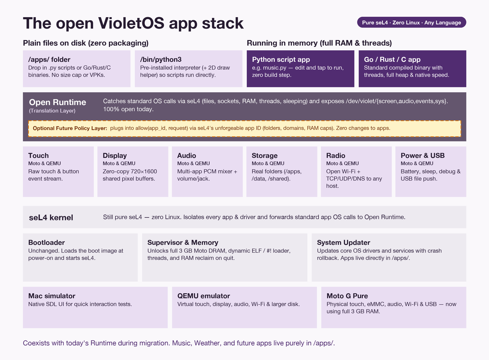

# RFC: Open, Polyglot App Model on Pure seL4

**Status:** Implemented for compiled programs and Python, with TCP, on QEMU and the Moto G Pure; persistent files remain. See [Implementation status](#implementation-status) and the [Open Runtime README](../runtime/open/README.md).
**Context:** Prompted by PR #13 (*Music*), where streaming an album required hardcoding `MUSIC_HOST` and `/tracks/NN.mp3` in `Radio`, embedding `minimp3` and playback state in `Audio`, adding a bespoke `MUSIC` key to `Runtime`, and squeezing cover art into 32×32 pixels to stay under the 128 KiB app limit.

## Goal

Run high-performance, fully capable apps in **essentially any language**—including drop-in Python scripts (no build/package step) and standard compiled Go, Rust, or C binaries—on **pure seL4 with zero Linux anywhere in the stack**.

- **100% open by default:** assume apps are trustworthy. No per-app URL allowlists, no 128 KiB package cap, no 4-file/4 KiB storage cap, and no pushing app logic into OS services.
- **Policy-ready by construction:** because seL4 still isolates every app in hardware and routes all external requests through one layer with an unforgeable app ID, a future policy layer plugs into a single hook (`runtime/open/policy.rs`) with zero changes to apps.
- **Coexists with today's Runtime:** existing `no_std` apps (`Launcher`, `Stopwatch`, `Wi-Fi Setup`) keep working untouched during migration.

## Architecture



```
  /apps/music/main.py  (#!/bin/python3)      /apps/music-go  (GOOS=linux GOARCH=arm)
                │                                           │
                └────────── standard ARM EABI `svc #0` ─────┘
                                     │
                     (seL4_Fault_UnknownSyscall IPC)
                                     ▼
          ┌─────────────────────────────────────────────────────┐
          │         Open Runtime / Translation Layer            │
          │  • Linux ARM EABI syscall dispatch (~60–80 calls)   │
          │  • Virtual devices: /dev/violet/{screen,audio,...}  │
          │  • Policy hook: OpenPolicy (allow all) -> optional  │
          └───────┬──────────┬──────────┬──────────┬────────────┘
                  ▼          ▼          ▼          ▼
             [Display]    [Audio]    [Radio]   [Storage]   [Touch] [Power]
              720×1600   PCM mixer  TCP/UDP/DNS Real FS     Raw     PMIC
              surfaces   (no mp3)   (any host)  (/apps)    events   & USB
                  └──────────────────────┬─────────────────────────┘
                                         ▼
                                    seL4 kernel
                           (pure seL4 — zero Linux)
                                         ▼
                      Supervisor & Dynamic Memory Manager
                   (full Moto G Pure DRAM, ELF/#! loader, threads)
```

## Skeleton Map

| File | Role |
| --- | --- |
| `runtime/open/abi.rs` | Language-agnostic binary structs for `/dev/violet/{screen,audio,events,sys}` |
| `runtime/open/policy.rs` | The capability policy (since replaced `OpenPolicy`): default deny, per-app manifests, per-app `/data`, read-only `/apps` (see [runtime/open/README.md](../runtime/open/README.md), Policy) |
| `runtime/open/syscall.rs` | `seL4_Fault_UnknownSyscall` → ARM EABI syscall dispatcher & async `WaitOn` |
| `runtime/open/mod.rs` | Open Runtime main event loop (never blocks on I/O; stashes reply caps) |
| `system/supervisor/procmgr.rs` | Full-DRAM `PagePool`, demand-paged `VmaTable`, ELF32 + `#!` shebang loader, threads |
| `services/open_contracts.rs` | Generalized raw interfaces for Display, Audio, Radio, and Storage |
| `apps/examples/music_py/main.py` | PR #13 Music app sketched as a zero-build Python script |
| `apps/examples/music_go/main.go` | PR #13 Music app sketched as a standard Go binary |

## Why ARM EABI Syscalls (Without Linux)

Almost every language toolchain already targets Linux ARM EABI (`armv7-linux-musleabihf` / `GOOS=linux GOARCH=arm GOARM=7`). On AArch32 seL4:

- seL4's own syscalls use negative `r7` (`-1..-32`).
- Linux ARM EABI uses positive `r7` (`0..450`, plus ARM-private `0xf0005` `set_tls`).
- They never collide. Any app `svc #0` traps directly into the Open Runtime via `seL4_Fault_UnknownSyscall` with zero kernel changes.
- Hot paths bypass syscalls completely: pixels are written directly into `mmap`'d surface memory, audio into an `mmap`'d PCM ring, and clocks read `CNTVCT` (`KernelArmExportVCNTUser=ON` is already enabled).

## Incremental Milestones (QEMU First → Moto G Pure)

1. **Unlock hardware & generalize services:** Map full usable Moto DRAM (beyond 50 MiB), enable VFPv4/NEON across userspace, mount a real folder filesystem (`/apps`, `/data`, `/shared`), and add raw PCM stream rings (`Audio`) + open TCP/UDP/DNS sockets (`Radio`).
2. **Dynamic process manager & first C/Rust `std` app:** Add `PagePool`, demand-paged `VMFault` handling, static ELF32 loader, and the first ~30 syscalls + `/dev/violet/{screen,audio,events}`.
3. **Zero-build Python apps:** Cross-compile CPython once against `armv7-linux-musleabihf` (with stdlib zip + a small native 2D drawing helper), install to `/bin/python3`, and add `#!` shebang launch.
4. **Threads, `epoll`, sockets → Go binaries:** Wire Radio sockets + `epoll_pwait`, `clone` threads, and `futex`. Start with `GODEBUG=asyncpreemptoff=1` for immediate Go support, then add full `ucontext` `SIGURG`/`rt_sigreturn` preemption.
5. **Polish:** Dynamic linking (`PT_INTERP`) if needed, background app audio/wake-lock lifecycle, and Cortex-A53 SMP.

## Open Questions

1. **AArch32 (`armhf`) vs. AArch64:** Staying AArch32 keeps the existing Moto bootloader, seL4 config, and Wi-Fi SMC patch untouched while supporting Go (`GOARM=7`), Rust, and CPython. Is AArch32 the right starting target?
2. **Storage partition on Moto:** Start with the unused ~15 MiB inside `boot_b` for dev, or mount a larger partition on eMMC?
3. **Fast 2D drawing for Python:** Bake a small native canvas module (e.g. `tiny-skia` + font rasterizer) into `/bin/python3`, or keep graphics strictly raw `mmap` buffers + user libraries?

## Implementation status

The Open Runtime is component 24. Unmodified Rust `std`, C (musl), Go and CPython 3.12 programs run in QEMU and on the Moto G Pure; `make test-open` checks each one. Details are in the [Open Runtime README](../runtime/open/README.md).

| Milestone | State |
| --- | --- |
| 1. Hardware and services | The supervisor gives the Open Runtime a 384 MiB (QEMU) or 256 MiB (handset) page pool beyond the kernel's 50 MiB. Floating point and NEON work in apps. Audio plays raw PCM from apps. Radio serves apps' TCP connections (DNS answered by the Open Runtime). **Not done:** a persistent folder file system (writes stay in memory); listening sockets and general UDP; the rest of the handset's DRAM. |
| 2. Process manager, first C and Rust programs | Done: 64 KiB demand paging, a static ELF loader (ET_EXEC and static PIE), about 150 system calls, `/dev/violet/{screen,events,sys,audio}`. |
| 3. Zero-build Python | Done: CPython 3.12.16 built statically against musl with zlib; `#!/bin/python3` scripts and bare `.py` files run from `/apps`. Drawing is raw `mmap` pixels for now. |
| 4. Threads, epoll, sockets, Go | Threads, futexes, `epoll`, `poll`, eventfd, pipes and TCP sockets are done; Go runs (`GODEBUG=asyncpreemptoff=1`) including `net/http` and TLS. Signals are delivered now (handlers, faults, asynchronous preemption; `make test-abi` runs Go without the flag); the flag stays until that suite has passed on the emulator and the handset. |
| 5. Polish | Not started: dynamic linking, background lifecycle beyond "keep running", multiple cores. |

Decisions made while implementing:

- **The Open Runtime builds app processes itself.** Rather than asking the supervisor to map each page, it receives its own CSpace, the ASID pool, kernel memory and the page pool, and is the fault handler of every app thread. The procmgr code lives in `system/supervisor/procmgr.rs` as the skeleton placed it, but is compiled into the Open Runtime.
- **Pages are 64 KiB.** Every pool page stays mapped in the Open Runtime too, which makes copying to and from apps a plain memory access and keeps the capability count manageable.
- **AArch32 stays** (open question 1). The kernel now uses `TPIDRURO` as its TLS register, which is what Linux ARM programs read.
- **The handset's image rides in the boot image's ramdisk** (open question 2), compressed, so no new eMMC partition is needed yet; the 16 MiB boot payload limit leaves about 7 MiB for more programs.
- **Coexistence uses Runtime's client 9.** Built-in apps are unchanged. Home's **/APPS** button gives the Open Runtime the screen; it draws the app list or the app in front itself.
