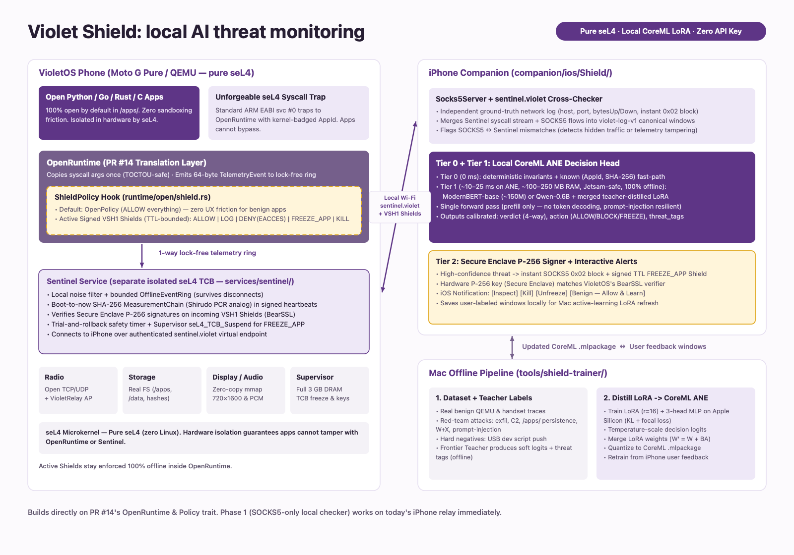

# RFC: Violet Shield — Local AI Threat Monitoring & Signed Live Shields on Pure seL4

**Status:** Draft RFC (code skeleton — assumes [PR #14 (`rfc/open-app-model`)](https://github.com/Immortal-Protocols/VioletOS/pull/14) is in; intentionally not wired into the build yet)  
**Inspiration:** [Shirudo](https://github.com/shirudo-dev/shirudo) (signed live runtime shields + tamper-resistant observability), adapted to VioletOS's pure-seL4 Open Runtime and iPhone companion relay — **with no Linux kernel, no cloud server, and no API key required**.

## Motivation

PR #14 opens VioletOS so any app (drop-in `.py` scripts, compiled Go/Rust/C binaries) runs at full speed with zero unnecessary sandboxing friction (`OpenPolicy` allows everything by default).

That openness creates a classic phone security problem: what if a third-party dependency, a downloaded script, or a compromised binary starts exfiltrating `/data/`, modifying `/apps/` for persistence, or attempting memory corruption?

On Linux, [Shirudo](https://github.com/shirudo-dev/shirudo) solves live detection and zero-reboot containment by fighting a monolithic kernel — adding kernel patches, a signed BPF loader ABI, early-boot BPF LSM sealing via `security.bpf.shirudo` xattrs, and TPM 2.0 measurements.

**VioletOS PR #14 already has a structurally stronger choke point:**
- Every app runs in a hardware-isolated seL4 address space with **zero direct capabilities** to hardware, sockets, or storage.
- Every syscall (`openat`, `connect`, `mprotect`, `clone`, `ioctl`, etc.) traps via `seL4_Fault_UnknownSyscall` into `OpenRuntime` with an **unforgeable seL4 badge (`AppId`)**, passing straight through `runtime/open/policy.rs`.
- `system/supervisor/supervisor.c` *already* verifies **P-256 ECDSA** signatures with BearSSL and supports trial-and-rollback (`usb_trial_timeout_ms`).
- The iPhone companion app (`companion/ios/`) *already* sits in your pocket, bridges VioletOS's network traffic through `Socks5Server.swift`, stays alive while locked (`KeepAlive.swift`), has native iOS notifications, and owns an **Apple Silicon Neural Engine (ANE)** + **Secure Enclave P-256 key**.

## Design Goals

1. **Preserve 100% open defaults:** `OpenPolicy` stays the default — zero permission popups or friction for normal apps and personal scripts.
2. **Zero cloud, zero API key, 100% private:** Continuous log/telemetry checking runs **locally on the iPhone companion** using a small **teacher-distilled LoRA + multi-head decision head** (~10–25 ms per window on CoreML ANE, fitting inside iOS's background Jetsam RAM budget).
3. **Two independent layers of ground truth:** Cross-check VioletOS's on-device syscall/exec telemetry (`sentinel.violet`) against the iPhone's own `Socks5Server` network log so a compromised app (or even tampered telemetry) cannot hide outbound traffic.
4. **Hardware-signed, zero-reboot live Shields:** When a threat is flagged, the iPhone immediately blocks the host in SOCKS5 (`0x02 notAllowed`) and pushes a **Secure Enclave P-256 signed, TTL-bounded Shield** (`VSH1`) over `sentinel.violet` to deny paths/hosts or **`FREEZE_APP`** (`seL4_TCB_Suspend` mid-syscall, keeping memory intact for inspection).
5. **Prompt-injection resilient:** Fixed classification logits trained adversarially (plus deterministic Tier-0 invariants) prevent a rogue app from hijacking free-form LLM generation via crafted filenames or domains.

## Architecture



```text
  /apps/*  (Go, Python, Rust, C — 100% open by default, isolated by seL4)
                  │  standard ARM EABI `svc #0`
                  ▼
  ┌──────────────────────────────────────────────────────────────────┐
  │  OpenRuntime (seL4 process — runtime/open/shield.rs)             │
  │   1. Copy syscall args into private buffer once (prevents TOCTOU)│
  │   2. ShieldPolicy (wraps OpenPolicy + active signed VSH1 rules)  │
  │        -> ALLOW | LOG_ALERT | DENY(EACCES) | FREEZE_APP | KILL   │
  │   3. Emit 64-byte TelemetryEvent -> lock-free shared ring        │
  └──────────────────────────┬───────────────────────────────────────┘
                             │ (one-way ring; no app holds a cap)
                             ▼
  ┌──────────────────────────────────────────────────────────────────┐
  │  Sentinel Service (separate seL4 process — services/sentinel/)   │
  │   • Local noise filter + bounded offline ring buffer             │
  │   • Boot-to-now SHA-256 MeasurementChain (Shirudo PCR analog)    │
  │   • Verifies Secure Enclave P-256 signatures on VSH1 Shields     │
  │   • Persistent authenticated link -> `sentinel.violet`           │
  └──────────────────────────▲───────────────────────────────────────┘
                             │  Local Wi-Fi (192.168.77.0/24 — zero cellular data)
                             ▼
  ┌──────────────────────────────────────────────────────────────────┐
  │  iPhone Companion Relay (companion/ios/Shield/)                  │
  │   • `Socks5Server` ground-truth network log + `0x02` instant ban │
  │   • `CanonicalWindowFormatter` (`violet-log-v1` + SOCKS5 cross-  │
  │     correlation flag `SOCKS5_SEEN=0/1`)                          │
  │   • Tier 0: deterministic invariants + known-good cache (0 ms)   │
  │   • Tier 1: Local CoreML ANE Student + LoRA + Decision Head      │
  │             (ModernBERT-base ~150M / Qwen-0.6B, ~10–25 ms)       │
  │   • Tier 2: Secure Enclave P-256 Shield signer + iOS alerts      │
  └──────────────────────────▲───────────────────────────────────────┘
                             │  Periodic Mac sync (opt-in active learning)
                             ▼
  ┌──────────────────────────────────────────────────────────────────┐
  │  Mac Teacher -> Student LoRA Pipeline (tools/shield-trainer/)    │
  │   • Benign traces from QEMU + daily handset usage                │
  │   • Synthetic red-team attacks (exfil, C2, W+X, prompt-inject)   │
  │   • Frontier Teacher soft-logit + tag distillation               │
  │   • LoRA (r=16) + 3-head decision head -> merge -> CoreML ANE    │
  └──────────────────────────────────────────────────────────────────┘
```

## Skeleton Map

| File | Role |
| --- | --- |
| `runtime/open/shield.rs` | `ShieldPolicy` implementing PR #14's `Policy` trait, TOCTOU-safe arg-copy note, active `VSH1` Shield rule table, `FREEZE_APP`/`KILL_APP` verdicts, and 64-byte lock-free `TelemetryEvent` ring |
| `services/sentinel/mod.rs` | Separate seL4 `Sentinel` process: `MeasurementChain` (per-boot SHA-256 PCR chain), P-256 `SignedShield` verifier + trial-and-rollback timer, `OfflineEventRing`, and `sentinel.violet` transport |
| `companion/ios/Shield/ShieldChecker.swift` | iPhone `sentinel.violet` handler (beside `time.violet`), `violet-log-v1` canonical formatter, SOCKS5 ↔ Sentinel cross-checker, CoreML ANE decision-head runner, Secure Enclave P-256 signer, and user-feedback store |
| `tools/shield-trainer/schema.py` | Shared `violet-log-v1` canonical window serializer, verdict/action/tag taxonomy, and red-team attack scenario definitions (including prompt-injection and SOCKS5-mismatch cases) |
| `tools/shield-trainer/distill_lora.py` | Mac training skeleton: Teacher soft-logit KL + focal/BCE distillation for Student backbone + LoRA (`r=16`) + multi-head decision head, temperature calibration, LoRA merge, and CoreML `.mlpackage` export |

## Key Design Decisions & Security Properties

1. **TOCTOU-free syscall inspection (refining PR #14):** In PR #14's `runtime/open/mod.rs`, `read_user_str` reads directly from linearly mapped app RAM. A multi-threaded hacked app could mutate a path buffer *between* `Policy::check()` and `StorageFsService::open()`. `OpenRuntime` must copy path/sockaddr arguments **once** into a private buffer, evaluate `ShieldPolicy` + log telemetry on that copy, and pass that exact private copy to the backing service.
2. **Background Jetsam RAM discipline on iPhone:** iOS enforces strict memory ceilings on background apps kept alive by `KeepAlive.swift`. The resident background checker targets a **150M–360M INT8/INT4 CoreML ANE encoder/LM** (~90–250 MB RAM) running single-forward-pass decision heads only — no background autoregressive decoding. Optional richer explanations run only when the user taps a notification in the foreground.
3. **Canonical `violet-log-v1` windows with developer context:** On an open phone where you regularly push new `.py` scripts and Go binaries, the window header includes `DEV_PUSH=0/1`, `BG=0/1`, `USER_IDLE`, and `NEW_HASH=0/1` so the decision head cleanly distinguishes *"you just pushed a script over USB and tapped it"* from *"a background script woke up at 3 AM and uploaded 4 MB to a new IP."*
4. **Two-tier signing & fail-safe rollback:** Auto-containment Shields signed by the iPhone are **TTL-bounded and reversible** (and auto-rollback if `Sentinel`'s heartbeat stalls, reusing `supervisor.c`'s trial pattern). Permanent policies or OS updates require explicit Face ID confirmation (Secure Enclave) or the Mac developer key.
5. **Attestation without a discrete TPM 2.0:** `Supervisor` + `Sentinel` maintain a per-boot ephemeral keypair and running SHA-256 `MeasurementChain` extended on every Shield load/unload, included in periodic signed heartbeats to the iPhone.
6. **Offline & Home Wi-Fi behavior:** Active Shields stay enforced locally inside `OpenRuntime` even when disconnected from the iPhone, while `Sentinel` buffers telemetry in `OfflineEventRing`. When VioletOS is on Home Wi-Fi rather than `VioletRelay`, the same `sentinel.violet` wire protocol can target the iPhone over LAN/Bonjour or fall back to the Mac.

## Incremental Milestones

1. **Phase 1 (usable immediately, zero seL4 changes):** Hook `ShieldChecker` into `companion/ios/App/Socks5Server.swift` to score outbound `(host, port, bytesUp, bytesDown)` flows locally on the iPhone and block malicious hosts with SOCKS5 `0x02`.
2. **Phase 2 (Mac training benchmark):** Build the `violet-log-v1` dataset from QEMU test runs + synthetic red-team traces, distill a `ModernBERT-base` or `Qwen3-0.6B` LoRA + decision head from a frontier Teacher, calibrate thresholds, and measure real precision/recall + CoreML ANE latency/RAM on the iPhone.
3. **Phase 3 (pairs with PR #14):** Wire `runtime/open/shield.rs` + `services/sentinel/` over `sentinel.violet` for full syscall/exec/hash/memory telemetry and SOCKS5 ↔ Sentinel cross-checking.
4. **Phase 4 (live signed enforcement + active learning):** Enable Secure Enclave P-256 signed `VSH1` Shield push (`DENY` / `FREEZE_APP`), trial rollback, and periodic Mac LoRA refreshes from user `[Benign]` / `[Threat]` notification taps.

## Open Questions

1. **Backbone choice:** Start with **ModernBERT-base (~150M)** (bidirectional encoder, ~100 MB RAM, safest under iOS background Jetsam) or **Qwen3-0.6B / SmolLM2-360M** (decision head in background + optional short text rationale in foreground)?
2. **Auto-containment default:** On high-confidence `P(malicious) >= 0.90`, should the iPhone automatically `FREEZE_APP` + block the host in SOCKS5 with a 10-minute TTL and notify you, or start in **Notify-only** mode until real-world false positive rate is measured?
3. **Shield expressiveness:** Are structured declarative `VSH1` rules (path/host/port/syscall match + rate limits) enough for v1, or should we include a tiny bounded `#![no_std]` eBPF/rBPF filter VM inside `OpenRuntime` right away?
